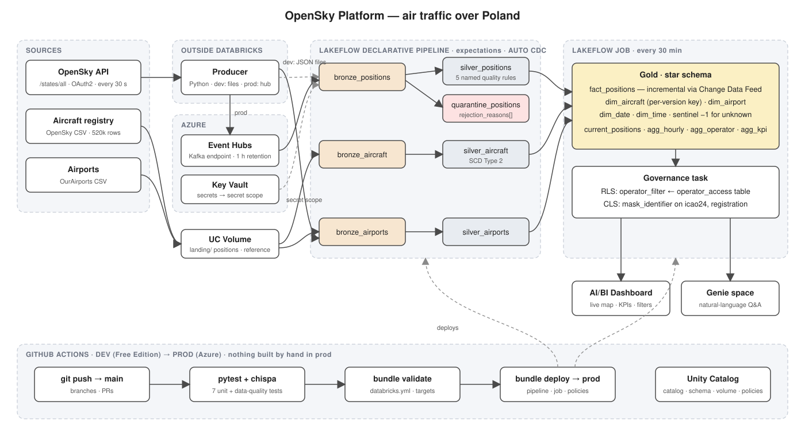

# OpenSky Platform — air traffic over Poland

An end-to-end data platform on Azure Databricks that ingests live aircraft positions
from the OpenSky Network, enriches them with aircraft and airport registries, and
serves them through a live-map dashboard and a natural-language assistant.
Built as the final project of the SoftServe Academy Databricks course.



## What it does

Every 30 seconds a producer polls the OpenSky API for every aircraft over Poland
(typically 100-150 at a time) and streams the positions into Azure Event Hubs.
A Lakeflow declarative pipeline lands them in bronze, validates them against five
named quality rules in silver, and historises the aircraft registry as SCD Type 2.
A scheduled job builds a gold star schema incrementally via Change Data Feed and
applies row- and column-level security. An AI/BI dashboard shows current positions
on a map, a Genie space answers questions about the traffic.

Everything is deployed to production through GitHub Actions and a Databricks Asset
Bundle, nothing on prod was built by hand.

## Architecture

| Layer | Objects | Notes |
|---|---|---|
| Sources | OpenSky `/states/all` (stream), OpenSky aircraft registry (CSV, 520k rows), OurAirports (CSV) | OAuth2 client credentials for the API |
| Producer | `producer/opensky_producer.py` | Runs outside Databricks; `file` sink on dev, `eventhub` sink on prod |
| Bronze | `bronze_positions`, `bronze_aircraft`, `bronze_airports` | Auto Loader (dev / registries) or Kafka source (prod), switched by bundle configuration |
| Silver | `silver_positions`, `quarantine_positions`, `silver_aircraft` (SCD2 via AUTO CDC), `silver_airports` | Rules live in `src/transformations.py`, shared with the tests |
| Gold | `fact_positions` (CDF-incremental), `dim_aircraft`, `dim_airport`, `dim_date`, `dim_time`, `current_positions`, `agg_*` | Per-version surrogate keys, as-of join, sentinel row for unknown aircraft |
| Governance | `operator_filter` (RLS), `mask_identifier` (CLS), `operator_access`, `privileged_users` | Applied as a job task after every gold build |
| Serving | AI/BI dashboard, Genie space | Built on gold only |

## Repository layout

.
├── databricks.yml # Asset Bundle: pipeline, job, dev/prod targets
├── .github/workflows/ci.yml # tests → validate → deploy to prod on main
├── src/
│ ├── transformations.py # pure functions: cleaning, quality rules, SCD helpers
│ ├── pipeline/opensky_pipeline.py
│ ├── gold/build_gold.py
│ └── governance/apply_policies.py
├── tests/ # pytest + chispa, 7 unit and data-quality tests
├── producer/opensky_producer.py # external stream producer
├── setup/ # one-off environment preparation
├── demo/ # walkthrough notebook used in the presentation
└── docs/architecture.svg


## Environments

| | dev | prod |
|---|---|---|
| Workspace | Databricks Free Edition | Azure Databricks |
| Catalog / schema | `workspace.opensky` | `dbr_dev.radekgryciukk_opensky` |
| Positions source | JSON files in a UC volume | Event Hubs via Kafka endpoint |
| Compute | serverless | serverless |
| Deployment | `databricks bundle deploy -t dev` | GitHub Actions on push to `main` |

The same pipeline code runs in both, only `databricks.yml` differs per target.

## Running it

**Prerequisites:** Databricks CLI, Python 3.11+, Java 17, an OpenSky account with an
API client, and (for prod) an Event Hub plus a Key Vault-backed secret scope named `opensky`.

```bash
pip install -r requirements.txt
TZ=UTC python -m pytest -v                       # 7 tests

databricks bundle validate -t dev
databricks bundle deploy -t dev
databricks bundle run opensky_refresh -t dev     # pipeline → gold → governance
```

Producer (never commit `.env`):

OPENSKY_CLIENT_ID=...
OPENSKY_CLIENT_SECRET=...
SINK=eventhub # or: file
EH_CONN_STR=... # eventhub mode only
EH_NAME=...


```bash
python producer/opensky_producer.py
```

Prod is deployed exclusively by CI. The job `opensky-refresh-prod` runs every
30 minutes because Event Hubs retention is one hour.

## Data quality

Five named rules on positions: `missing_icao24`, `missing_position`, `outside_bbox`,
`implausible_altitude`, `implausible_speed`. Failing rows go to `quarantine_positions`
with the full list of reasons rather than being dropped. On the first production run
the speed rule caught real ADS-B transponder faults: several aircraft reporting
1,980 m/s (over 7,000 km/h) for their entire observation window.

## Security

Secrets (Event Hubs connection string, OpenSky client secret) live in Azure Key Vault
and are read through a secret scope at run time: the repository and bundle carry only
names. Row-level security is table driven: `operator_access` maps users to the
operators they may see. Column masks hide `icao24` and `registration` from users
outside `privileged_users`. Policies are reapplied by the job after every gold rebuild.

## Known limitations

- The producer runs on a developer machine, a production deployment would host it as
  an Azure Container App or Function.
- The OpenSky registry covers ~65% of observed aircraft, the rest resolve to a sentinel
  dimension row rather than being lost.
- Event Hubs retention is 1 hour (namespace policy), which forces the 30-minute job cadence.
- `fact_positions` loads incrementally via CDF, dimensions and aggregates are rebuilt in full,
  which is fine at this volume.